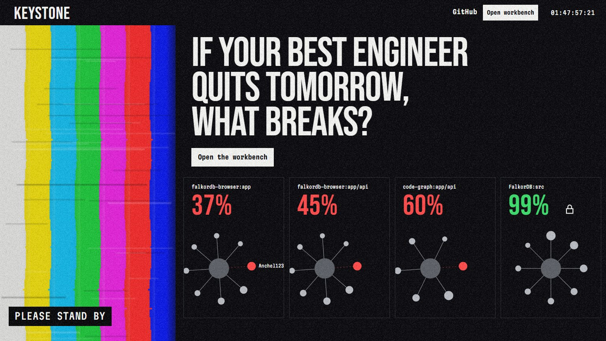
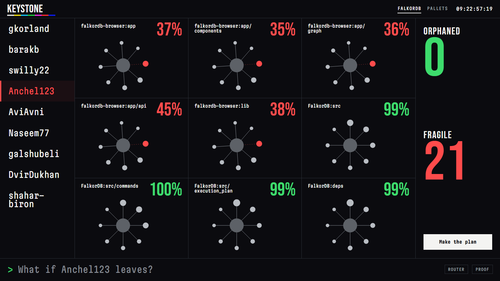
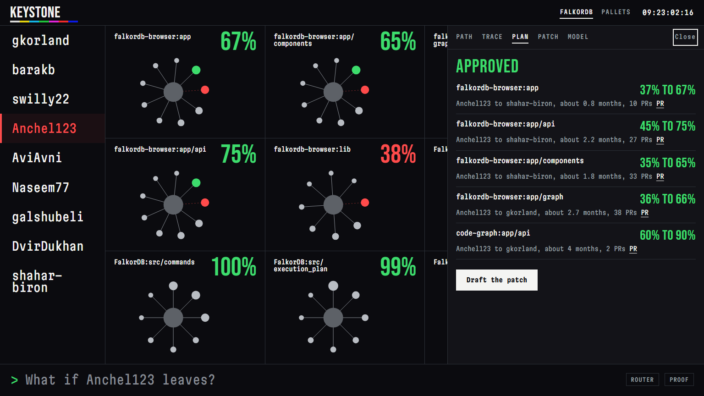
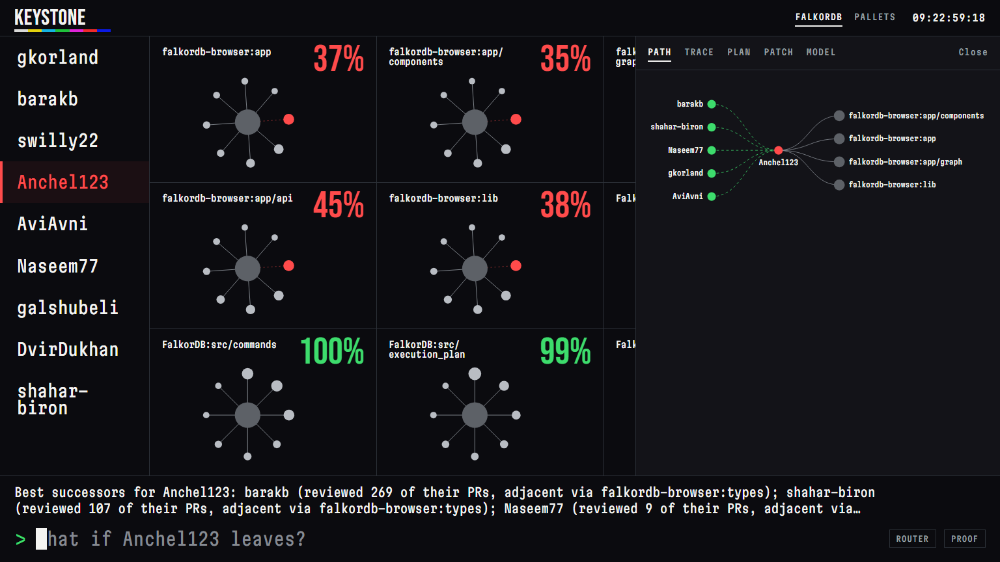

# Keystone

**An MCP-native agent that answers "if this person leaves, what breaks, and who steps in?" from an organisation's real merged-PR history, held as a graph in FalkorDB.**

Built for **Graph Hacks: Context for AI Agents** (WeMakeDevs x FalkorDB). **Track entered: Track 01, Agents That Act on Connected Data.**

| | |
|---|---|
| Live demo | _to be added after deployment_ |
| Demo video | _to be added_ |
| Blog post | _to be added_ |
| MCP endpoint | `<live demo URL>/mcp` (streamable HTTP) |





The workbench: choose a person (left) and the nine modules show how much knowledge stays if they leave, with the totals on the right. **Make the plan** runs the three-role review and heals the wall; the command line at the bottom talks to the same agent that serves `/mcp`; **PROOF** draws the path behind the last answer.





New to the project? Read [docs/HOW_IT_WORKS.md](docs/HOW_IT_WORKS.md).

## What it does

1. **Finds where knowledge is concentrated.** Every merged pull request is a fact: who authored it, who reviewed it, which module it touched. Keystone turns those facts into a `KNOWS` graph with time decay and computes bus factor, how load-bearing each module is (PageRank), and who bridges teams (betweenness).
2. **Runs the counterfactual.** "What if @Anchel123 leaves?" forks the live graph with `GRAPH.COPY`, deletes the person on the fork, recomputes the same statistics and diffs them. The live graph is never touched, and the fork is deleted afterwards.
3. **Finds who can really step in, with the path.** Successors are ranked by multi-hop evidence: who already reviewed the leaver's PRs, and who knows modules that change together with the target module (`CO_CHANGES`). Every answer carries the nodes, edges and public PR links that produced it.
4. **Acts.** Three roles hand off through graph state: the *Analyst* runs the what-if, the *Planner* simulates a pairing plan on a fork and writes a Decision with Tasks, the *Reviewer* reads those Tasks back from the graph and re-verifies on a fresh fork. An approved plan becomes reviewable artifacts: a CODEOWNERS patch diffed against the repository's real file, and an issue per pairing. All of it is a dry run unless the operator opts in.
5. **Remembers and checks itself.** Decisions and tasks are ordinary nodes. A later session asks `changes_since`: did the plan happen, judged from real PR activity rather than from a checkbox.

Ask it in plain English, or drive the same tools from Claude Desktop, Claude Code or any MCP client.

## Why this needs a graph

"Who steps in for her?" is a path question: `Person -AUTHORED-> PR -TOUCHES-> Module <-TOUCHES- PR <-REVIEWED- Person`, plus `Module -CO_CHANGES- Module`. A table of commit counts cannot show the chain. A vector index cannot compute a counterfactual. FalkorDB is the primary and central store, and the product stops working without it:

- `algo.pageRank`, `algo.labelPropagation` and `algo.betweenness` run in the database at load and write their results back as properties.
- `algo.SPpaths` finds the weighted shortest chain of shared knowledge between two people or a person and a module.
- `GRAPH.COPY` is the counterfactual engine for `what_if_leaves`, the Planner and the Reviewer.
- One graph per organisation, plus a private `GRAPH.COPY` sandbox per visitor, so writes never leak between users.
- Read tools run through `GRAPH.RO_QUERY`, so a read tool cannot mutate the graph.

## Track 01 map

| Track 01 focus | Where it lives |
|---|---|
| Multi-hop reasoning | `successors` (reviewed-for + co-change adjacency), `path_between` (`algo.SPpaths`), `what_if_leaves` |
| Graph queries and algorithms as agent tools | 15 human-written tools in `keystone/tools.py`, `memory.py`, `workflow.py`, `actions.py`; algorithms in `load.ALGOS` |
| Tool selection through MCP | `keystone/mcp_server.py`; the in-app agent lists and calls tools through the MCP protocol on every request (`keystone/agent.py`); also served at `/mcp` |
| Actions based on what the graph shows | `succession_review` (writes Decision and Tasks), `draft_actions` (CODEOWNERS patch and issues, dry run), optional `execute` into one repo you own |
| Explainable results | every result carries `path` and `sources` built from the same rows as the answer; four explicit outcomes: `answered`, `from_memory`, `not_in_graph`, `unknown_entity` |

## Architecture

```
 browser UI ──► FastAPI ──► agent loop ──► MCP client ══(MCP protocol)══► MCP server ──► tools ──► FalkorDB
                  │             │                                              ▲                     │  GRAPH.RO_QUERY
                  │             └── LLM (optional) picks tools; never writes Cypher                  │  GRAPH.COPY forks
                  └──── /mcp (streamable HTTP) ───────────────────────────────┘                     └─ algo.* procedures
 Claude Desktop / Claude Code / any MCP client ──► stdio or /mcp
```

The model only chooses tools and phrases the answer. Names are validated: a person mentioned in the prose must appear in the tool rows, otherwise the prose is discarded and the rows are rendered instead. Without an LLM key a deterministic router makes the same MCP calls and the UI labels the mode. With keys you can set a primary and a backup model (`LLM_*` and `LLM2_*`): if the primary is slow, rate-limited or down the backup answers, and if both fail the router does, so a provider outage never breaks the demo.

## Graph data model

Nodes (one graph per tenant, `ks_<tenant>`):

| Node | Key properties |
|---|---|
| `Person` | `id` (GitHub login), `active`, `first_ts`, `last_ts`, `broker` (betweenness) |
| `PR` | `id` (`owner/repo#n`), `title`, `url`, `ts`, `nmods` |
| `Module` | `id` (`owner/repo:path`), `kind` (code, ci, tests, docs, root), `n_prs`, `importance` (PageRank), `cluster`, `total` |
| `Repo`, `Issue` | `id`, `url` |
| `Meta` | snapshot date, half-life, counts |

Edges from the data: `(Person)-[:AUTHORED]->(PR)`, `(Person)-[:REVIEWED {state}]->(PR)`, `(PR)-[:TOUCHES {share, files}]->(Module)`, `(PR)-[:CLOSES]->(Issue)`, `(Module)-[:IN]->(Repo)`.

Edges derived inside FalkorDB: `(Person)-[:KNOWS {score, share, authored, reviewed, last, cost}]->(Module)`, `(Person)-[:CO_KNOWS {w, shared}]->(Person)` (both directions), `(Module)-[:CO_CHANGES {n}]->(Module)` (both directions).

Agent memory, as ordinary nodes in the same graph: `Session`, `Finding`, `Decision`, `Task`, `Snapshot`, `Run`, `Step`, `Action`, linked by `ABOUT`, `PRODUCED`, `IMPLEMENTS`, `OBSERVED`, `HAS_STEP`, `NEXT {handoff}`, `FOR`.

Every statement is listed in [docs/QUERIES.md](docs/QUERIES.md), generated from the code that runs.

## How "knowledge" is defined

- `knowledge(p, m)` = the sum over PRs that `p` authored (weight 1.0) or reviewed (weight 0.4), times the share of that PR's files landing in module `m`, times a time decay with a 365-day half-life.
- `share(p, m)` = `knowledge(p, m)` divided by everyone's knowledge of `m`.
- **Bus factor** = the fewest people whose combined share reaches 50%.
- **Active** = authored or reviewed a PR within 180 days of the snapshot. **Orphaned** = active people hold under 25% of a module's accumulated knowledge.
- Bots are excluded. Mass changes (over 300 files) and lockfiles, vendored and generated paths are ignored.

These are structural facts about contribution patterns. They describe a team; they do not evaluate anyone.

## The tools (MCP)

`overview`, `find_modules`, `module_risk`, `risk_scan`, `keystones`, `what_if_leaves`, `successors`, `who_knows`, `knowledge_map`, `path_between`, `recall`, `changes_since`, `succession_review`, `draft_actions`, `note_finding`. Each docstring is the description the model sees, so it says when to use the tool.

## Run it

Needs Docker, Python 3.11+ and [uv](https://docs.astral.sh/uv/). The repository carries the data snapshots (about 700 KB), so no GitHub access is needed.

```bash
docker compose up --build            # app on http://localhost:8000, FalkorDB Browser on http://localhost:3000
```

or without compose:

```bash
docker run -d --name keystone-db -p 6379:6379 -p 3000:3000 falkordb/falkordb:latest
uv sync
uv run python -m keystone.bootstrap  # builds both graphs and the demo memory in about 6 seconds
uv run uvicorn keystone.api:app --port 8000
uv run pytest                        # tests need the database running
```

Optional but recommended: copy `.env.example` to `.env` and add a key (`ANTHROPIC_API_KEY`, or `LLM_API_KEY` plus `LLM_BASE_URL` for any OpenAI-compatible endpoint, or a local model through Ollama, see the file). With a model, the model chooses the tools; without one the app still answers through its deterministic router and the button at the bottom right says ROUTER.

### Use it from Claude Desktop or Claude Code

stdio (local):

```json
{ "mcpServers": { "keystone": { "command": "uv", "args": ["--directory", "/path/to/keystone", "run", "python", "-m", "keystone.mcp_server"],
                                "env": { "KEYSTONE_TENANT": "falkordb" } } } }
```

HTTP (the running app, or the live demo): `claude mcp add --transport http keystone http://localhost:8000/mcp`

### Refresh the data

```bash
uv run python -m keystone.fetch OWNER/REPO ...     # needs `gh auth login` or GITHUB_TOKEN; reads public merged PRs only
uv run python -m keystone.snapshot                 # compress into data/snapshot
uv run python -m keystone.bootstrap --force
```

## Evaluation (honest)

`bench/backtest.py` runs the successor ranking **as of 2026-04-15** and compares it with who actually took over each module's knowledge by 2026-10-15. Cases are modules where one active person held at least 40% (bus factor 1).

| Organisation | Cases | Keystone hit@3 | Next-largest holders | Busiest contributors | Random |
|---|---|---|---|---|---|
| FalkorDB (21 active people at T0) | 19 | 0.95 | 0.95 | 0.95 | 0.39 |
| Pallets (T0 2026-01-15, 49 active) | 2 | 1.00 | 1.00 | 1.00 | 0.18 |

Pallets has only two qualifying cases, so its row is listed for completeness and proves nothing on its own (`bench/backtest_pallets.json`).

What this shows and what it does not: Keystone's recommendations come true far more often than chance. In teams this small, though, simple heuristics tie the graph ranking, because the plausible successors are the same handful of people. The graph earns its place through the explanation (the path), the counterfactual (`what_if_leaves` on a fork) and the verified plan, not by out-guessing a "second-largest holder" rule.

Latency on the real FalkorDB snapshot (3,664 PRs, 62 people, 114 tracked modules), local Docker, 30 runs each (`python -m bench.latency`): single-query tools take 1 to 17 ms at p50 (`successors`, three queries, 50 ms); `what_if_leaves`, which forks the whole graph with `GRAPH.COPY`, deletes the person and recomputes, takes 113 ms at p50 and 221 ms at p95; the full three-role review takes about 0.9 s. Traversals are fast enough to run on every step of an agent loop.

### Evaluating the agent itself

`bench/agent_eval.py` asks the agent real questions about the FalkorDB graph and scores three things per question: **tools** (every tool we expect was called; with no expected tool, none may be called), **outcome** (`answered`, `from_memory`, `not_in_graph` or `unknown_entity` is the right one) and **grounded** (every person named in the answer is in the tool rows). Each question runs in its own `GRAPH.COPY` sandbox. Three sets keep the numbers honest:

| Set | Questions | Tools | Outcome | Grounded | What it is |
|---|---|---|---|---|---|
| `dev` | 27 | 100% | 100% | 100% | the questions the router was built against, so a regression test and not a result |
| `heldout` | 26 | 100% | 100% | 100% | first run was **62%** tools; fixing the gaps it exposed lifted it, so it is no longer unseen |
| `fresh` | 20 | **65%** | **85%** | 100% | written after those fixes and never used to change the router: its real generalisation |

Router rows (`python -m bench.agent_eval --set fresh`). Read the `fresh` row as the truth about the no-key fallback: it routes everyday wording correctly about two times in three and never names a person the tools did not return. That is why the product is built around a model choosing the tools. With a key (or Ollama) set, run `python -m bench.agent_eval --llm` to score the model on the same questions; the model sees the 15 tool descriptions and nothing else, and its prose is discarded if it names anyone the tools did not return.

The real model path is also covered by tests that need no key (`FakeModel` in `tests/test_keystone.py`): tool calls go through MCP, the model can never choose a tenant, ungrounded prose is discarded, and an empty, slow, failing or tool-less model falls back to the router without leaking the key.

## Safety, privacy and limits

- Public data only: merged pull requests of public repositories. GitHub logins appear (they are public); email addresses are never requested or stored.
- The public deployment serves read-only base graphs; every visitor works in a private `GRAPH.COPY` sandbox that is deleted after a few hours.
- A visitor's own LLM key is used for that single request, is never stored or logged, and may only target an allowlist of provider hosts.
- Actions are dry runs. Posting is off unless the operator sets `KEYSTONE_GH_REPO` (one repository they own) and `GITHUB_TOKEN`, and the request carries `confirm=true`.
- Limits: PR history is a proxy for knowledge (it misses design discussions, on-call work and direct pushes); module boundaries are directory heuristics; the successor ranking was only backtested on two organisations.

## AI assistance disclosure

Required by the hackathon rules, so stated plainly:

- The code in this repository was written with an AI coding assistant, **Claude Code (Anthropic)**, working under the direction of the team during the event window (Oct 17 to 18, 2026).
- Interface comps were generated with Figma AI (image model `gpt-image-2.5-sunburst`, through the Figma MCP) and used as visual targets; the interface itself is hand-built HTML, CSS and JavaScript.
- The team is responsible for the architecture, security, correctness and every claim above and can explain the graph model, the queries and the decisions.

_Team: who did what_ (to be completed by the team before submission):

- _name_: _role and contribution_

## Repository layout

```
keystone/   load.py (ingest + derived graph), tools.py (the tool catalog), memory.py, workflow.py (3 roles), actions.py,
            mcp_server.py, agent.py (LLM or router, via MCP), llm.py, api.py (FastAPI + /mcp), bootstrap.py, fetch.py
web/        hand-built UI (landing + workbench, no framework)   data/snapshot/  real public PR history, gzip
bench/      backtest and latency     tests/   pytest against FalkorDB      deploy/ + Dockerfile  one-container deploy
docs/       QUERIES.md (generated), HOW_IT_WORKS.md, DEMO_SCRIPT.md, DEPLOY.md, BLOG.md, design/ (the Figma AI comps the UI was built to)
scripts/    capture.ps1 (screenshots), deploy-hf.ps1 (push to a Hugging Face Space)      PRODUCT.md, DESIGN.md  design context
```

## License

MIT. Data comes from the public GitHub API; repository names and logins belong to their owners.
